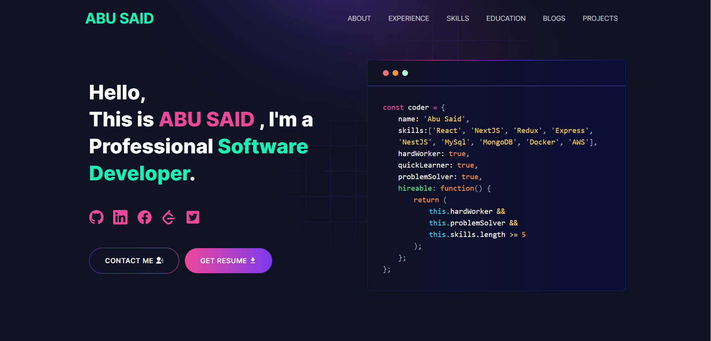

<p align="center">
  
  
  
</p>

<h1 align="center">Éabha Kenny</h1>

<p align="center">
  <strong>Software Design Student graduating this year</strong>
</p>

<p align="center">
  <a href="https://github.com/eabhakenny17">GitHub</a> •
  <a href="https://www.linkedin.com/in/éabha-kenny-b1b1282a6/">LinkedIn</a> •
  <a href="mailto:eabhakenny17@gmail.com">Email</a>
</p>

---

## About Me

I am Éabha Kenny, a Software Design student at Technological University of the Shannon, on track to graduate with First Class Honours this year. I am passionate about building software that is practical, user-focused, and creatively driven.

My work spans C#, Java, Python, C++, Unity, and modern developer workflows, with a strong interest in software engineering, interactive systems, and AI-assisted development. I enjoy solving real problems through clean design, strong fundamentals, and thoughtful user experiences.

## Skills

### Programming Languages
- C#
- Java
- Python
- C++
- JavaScript
- HTML/CSS
- SQL

### Tools & Technologies
- Unity (2D, 3D, VR, and AR)
- Git and GitHub
- VS Code
- Object-oriented design and software architecture
- AI-assisted developer tools
- Prompt engineering and productivity workflows

## Portfolio

This repository is my personal portfolio website, designed to showcase my software projects, academic journey, skills, and professional profile. It serves as a central hub for my work and acts as a digital introduction to who I am as a developer and student.

You can also explore more of my project work here:

- [EabhasProjects](https://github.com/eabhakenny17/EabhasProjects)

## Project Focus

I enjoy building projects that combine technical problem-solving with creativity, including:

- software engineering projects
- interactive and game-based experiences in Unity
- practical applications and coursework projects
- exploratory development using emerging tools and workflows
- solutions that improve usability and user experience

## Why I Build

I am motivated by the challenge of turning ideas into functional, meaningful software. I enjoy learning quickly, collaborating effectively, and building work that is both technically strong and genuinely useful.

## Education & Goals

I am a final-year Software Design student graduating this year and looking to continue developing as a software engineer. My goal is to keep growing in software development, problem-solving, and innovative product work while contributing to projects that make a real impact.

## Tech Stack Used for This Portfolio

This portfolio site is built with:

- Next.js
- React
- Tailwind CSS
- JavaScript

It is designed to be modern, responsive, and easy to navigate while presenting my work in a polished and professional way.

## Connect

I am always open to collaboration, career conversations, and opportunities in software development.

- GitHub: https://github.com/eabhakenny17
- LinkedIn: https://www.linkedin.com/in/éabha-kenny-b1b1282a6/
- Email: eabhakenny17@gmail.com
- Location: Athlone, Co. Westmeath, Ireland

---

<p align="center">
  <strong>Built with passion for software, learning, and problem-solving.</strong>
</p>

## Demo :movie_camera:

<p align="center">
  
</p>

<p align="center">
  <a href="https://abusaid.netlify.app/" target="_blank">
    <strong>🚀 View Live Demo</strong>
  </a>
</p>

---

## Features :sparkles:

- ✅ **Cutting-Edge Tech Stack**: Built with Next.js 16, React 19, and Tailwind CSS 4
- ✅ **Fully Responsive**: Optimized for all devices and screen sizes
- ✅ **SEO Optimized**: Better visibility on search engines with Next.js metadata API
- ✅ **Blazing Fast Performance**: Leverages Next.js 16 server components and streaming
- ✅ **App Router**: Uses the modern Next.js App Router architecture
- ✅ **Easy Customization**: Simple data-driven configuration
- ✅ **Contact Form**: Integrated email and Telegram notifications
- ✅ **Blog Integration**: Automatically fetch posts from dev.to
- ✅ **Dark Theme**: Beautiful gradient design with Lottie animations
- ✅ **Docker Support**: Easy containerized deployment
- ✅ **Google Analytics**: Track visitor insights with GTM support

---

## Next.js 16 Features Used :rocket:

This portfolio leverages the latest Next.js 16 and React 19 capabilities:

| Feature                  | Benefit                                                      |
| ------------------------ | ------------------------------------------------------------ |
| **App Router**           | Modern routing with layouts and nested routes                |
| **Server Components**    | Improved performance with zero JavaScript for static content |
| **Server Actions**       | Simplified form handling in contact page                     |
| **Metadata API**         | Enhanced SEO with type-safe metadata                         |
| **Image Optimization**   | Automatic image optimization with `next/image`               |
| **Font Optimization**    | Automatic font loading with `next/font`                      |
| **Streaming & Suspense** | Better loading states and progressive rendering              |
| **React 19 Features**    | Actions, use hook, and improved hydration                    |

---

## Sections :bookmark:

| Section           | Description                                         |
| ----------------- | --------------------------------------------------- |
| 🦸 **Hero**       | Eye-catching introduction with animated elements    |
| 👤 **About Me**   | Personal information and professional summary       |
| 💼 **Experience** | Work history and professional accomplishments       |
| 🛠️ **Skills**     | Technical skills with animated marquee display      |
| 🚀 **Projects**   | Showcase your best work with descriptions and links |
| 🎓 **Technical Experience** | Academic and project experience                      |
| 📝 **Blog**       | Latest articles from dev.to (auto-fetched)          |
| 📧 **Contact**    | Get in touch form with email/Telegram integration   |

---

## Table of Contents :scroll:

- [Overview](#overview)
- [Demo](#demo-movie_camera)
- [Features](#features-sparkles)
- [Sections](#sections-bookmark)
- [Tech Stack](#tech-stack-computer)
- [Installation](#installation-arrow_down)
- [Getting Started](#getting-started-dart)
- [Usage](#usage-joystick)
- [Deployment](#deployment-rocket)
- [Tutorials](#tutorials-wrench)
  - [Gmail App Password Setup](#gmail-app-password-setup)
  - [Create a Telegram Bot](#create-a-telegram-bot)
  - [Fetching Blog from dev.to](#fetching-blog-from-devto)
- [Packages Used](#packages-used-package)
- [Contributing](#contributing-handshake)
- [License](#license-page_with_curl)
- [Support](#support-coffee)

---

## Tech Stack :computer:

| Technology       | Version | Purpose                                   |
| ---------------- | ------- | ----------------------------------------- |
| **Next.js**      | 16.0.1  | React framework with App Router           |
| **React**        | 19.2.0  | UI component library with latest features |
| **Tailwind CSS** | 4.x     | Utility-first CSS framework               |
| **SASS**         | Latest  | CSS preprocessor                          |
| **Lottie**       | Latest  | Lightweight animations                    |
| **Nodemailer**   | Latest  | Email sending functionality               |
| **Axios**        | Latest  | HTTP client for API requests              |
| **Docker**       | -       | Containerization platform                 |

---

## Installation :arrow_down:

### Prerequisites

Before you begin, ensure you have the following installed on your machine:

| Tool                   | Minimum Version | Download Link                               |
| ---------------------- | --------------- | ------------------------------------------- |
| **Node.js**            | v18.17.0+       | [Download](https://nodejs.org/en/download/) |
| **Git**                | Latest          | [Download](https://git-scm.com/downloads)   |
| **pnpm** (recommended) | Latest          | [Install](https://pnpm.io/installation)     |

> **Note**: Next.js 16 requires Node.js 18.17 or later. Node.js 20+ is recommended for optimal performance.

#### Verify Installation

Check your installations with these commands:

```bash
node --version
git --version
pnpm --version  # or npm --version
```

---

## Getting Started :dart:

### 1. Fork and Clone the Repository

```bash
git clone https://github.com/<YOUR_GITHUB_USERNAME>/developer-portfolio.git
cd developer-portfolio
```

### 2. Install Dependencies

```bash
# Using pnpm (recommended)
pnpm install

# Using npm
npm install

# Using yarn
yarn install
```

### 3. Set Up Environment Variables

```bash
cp .env.example .env
```

Edit the `.env` file with your values (see [Usage](#usage-joystick) section).

### 4. Run the Development Server

```bash
pnpm dev
# or
npm run dev
# or
yarn dev
```

Open [http://localhost:3000](http://localhost:3000) in your browser.

---

### 🐳 Docker Deployment (Alternative)

#### Option 1: Using Docker Compose (Recommended)

```bash
docker-compose up --build

# Run in detached mode
docker-compose up -d --build

# Stop
docker-compose down
```

#### Option 2: Using Docker Directly

**For Development:**

```bash
# Build the development image
docker build -t developer-portfolio:dev -f Dockerfile.dev .

# Run the container
docker run -p 3000:3000 --name portfolio-dev developer-portfolio:dev

# Stop and remove container
docker stop portfolio-dev && docker rm portfolio-dev
```

**For Production:**

```bash
# Build the production image
docker build -t developer-portfolio:prod -f Dockerfile.prod .

# Run the production container
docker run -p 3000:3000 --name portfolio-prod developer-portfolio:prod
```

---

## Usage :joystick:

### Environment Variables Configuration

Create a `.env` file in the root directory with the following variables:

```env
# Google Tag Manager (Optional - for analytics)
NEXT_PUBLIC_GTM=GTM-XXXXXXX

# Your deployed app URL
NEXT_PUBLIC_APP_URL=https://your-domain.com

# Telegram Bot Configuration (for contact form notifications)
TELEGRAM_BOT_TOKEN=your_bot_token_here
TELEGRAM_CHAT_ID=your_chat_id_here

# Gmail Configuration (for contact form emails)
GMAIL_PASSKEY=your_gmail_app_password
EMAIL_ADDRESS=your_email@gmail.com
```

#### Variable Descriptions:

| Variable              | Required | Description                                  |
| --------------------- | -------- | -------------------------------------------- |
| `NEXT_PUBLIC_GTM`     | No       | Google Tag Manager ID for analytics tracking |
| `NEXT_PUBLIC_APP_URL` | Yes      | Your portfolio's public URL                  |
| `TELEGRAM_BOT_TOKEN`  | No       | Token for Telegram bot notifications         |
| `TELEGRAM_CHAT_ID`    | No       | Your Telegram chat ID for receiving messages |
| `GMAIL_PASSKEY`       | No       | Gmail app password for email notifications   |
| `EMAIL_ADDRESS`       | No       | Your Gmail address for sending emails        |

> **Note**: Contact form features require either Telegram or Gmail configuration (or both).

---

### Customize Your Portfolio Data

All portfolio content is managed through data files in the `utils/data/` folder:

#### 📝 Personal Information (`personal-data.js`)

```javascript
export const personalData = {
  name: "YOUR NAME",
  profile: "/profile.png", // Path to your profile image
  designation: "Software Developer", // Your job title
  description: "Your bio and introduction...", // About yourself
  email: "your.email@example.com",
  phone: "+1234567890",
  address: "City, Country",
  github: "https://github.com/yourusername",
  facebook: "https://www.facebook.com/yourprofile",
  linkedIn: "https://www.linkedin.com/in/yourprofile",
  twitter: "https://twitter.com/yourusername",
  stackOverflow: "https://stackoverflow.com/users/your-id",
  leetcode: "https://leetcode.com/yourusername/",
  devUsername: "yourusername", // dev.to username for blog integration
  resume: "https://link-to-your-resume.pdf",
};
```

#### 💼 Additional Data Files

| File               | Purpose                                        |
| ------------------ | ---------------------------------------------- |
| `experience.js`    | Your work experience and job history           |
| `projects-data.js` | Portfolio projects with descriptions and links |
| `skills.js`        | Technical skills and competencies              |
| `technical-experiences.js` | Academic and project experience           |
| `contactsData.js`  | Contact form configuration                     |

#### 🎨 Adding Your Profile Image

Place your profile picture in the `public/` directory and update the `profile` field in `personal-data.js`:

```javascript
profile: "/your-image-name.png"; // or .jpg, .webp
```

---

## Deployment :rocket:

### 🚀 Deploy to Vercel (Recommended)

[](https://vercel.com/new/clone?repository-url=https://github.com/said7388/developer-portfolio)

**Manual Deployment:**

1. Sign up at [Vercel](https://vercel.com/)
2. Import your GitHub repository
3. Add environment variables in **Settings** → **Environment Variables**
4. Deploy

**Features:**

- Native Next.js 16 support
- Automatic deployments on push
- Preview deployments for PRs
- Edge runtime support
- Global CDN and free SSL

---

### 🌐 Deploy to Netlify

[](https://app.netlify.com/start/deploy?repository=https://github.com/said7388/developer-portfolio)

**Manual Deployment:**

1. Sign up at [Netlify](https://www.netlify.com/)
2. Import your GitHub repository
3. Build command: `npm run build`
4. Publish directory: `.next`
5. Add environment variables in **Site Settings** → **Environment**

---

### 🐳 Deploy with Docker

```bash
# Build production image
docker build -t developer-portfolio:prod -f Dockerfile.prod .

# Run
docker run -d -p 80:3000 --name portfolio developer-portfolio:prod

# Or use Docker Compose
docker-compose -f docker-compose.prod.yml up -d
```

---

## Tutorials :wrench:

### 📧 Gmail App Password Setup

1. Go to [https://myaccount.google.com/](https://myaccount.google.com/)
2. Navigate to **Security** → **2-Step Verification** (enable if not already)
3. Go to **Security** → **App Passwords**
4. Select app: **Mail**, device: **Other (Custom name)**
5. Generate and copy the 16-character password
6. Add to `.env` file:

```env
GMAIL_PASSKEY=abcd efgh ijkl mnop
EMAIL_ADDRESS=your.email@gmail.com
```

---

### 🤖 Create a Telegram Bot

1. Open Telegram and search for `@BotFather`
2. Send `/newbot` command
3. Set bot name and username (must end with `bot`)
4. Copy the bot token
5. Send a message to your bot
6. Get chat ID from: `https://api.telegram.org/bot<BOT_TOKEN>/getUpdates`
7. Add to `.env` file:

```env
TELEGRAM_BOT_TOKEN=123456789:ABCdefGHIjklMNOpqrsTUVwxyz
TELEGRAM_CHAT_ID=123456789
```

---

### 📝 Fetching Blog from dev.to

1. Create a [dev.to](https://dev.to/) account
2. Open `utils/data/personal-data.js`
3. Set your dev.to username:

```javascript
export const personalData = {
  // ... other fields
  devUsername: "yourusername",
};
```

The portfolio automatically fetches and displays your latest public articles. No API key required.

---

## Packages Used :package:

### Core Dependencies

| Package         | Version | Purpose                                                      |
| --------------- | ------- | ------------------------------------------------------------ |
| **next**        | ^16.0.1 | Latest React framework with App Router and Server Components |
| **react**       | ^19.2.0 | JavaScript library with improved concurrent rendering        |
| **react-dom**   | ^19.2.0 | React package for working with the DOM                       |
| **tailwindcss** | ^4.1.16 | Modern utility-first CSS framework                           |
| **sass**        | Latest  | CSS preprocessor for styling                                 |

### UI & Animations

| Package                | Purpose                                    |
| ---------------------- | ------------------------------------------ |
| **lottie-react**       | Lightweight animations with Lottie files   |
| **react-fast-marquee** | Smooth scrolling marquee component         |
| **react-icons**        | Popular icon library with easy integration |
| **react-toastify**     | Beautiful notification toasts              |

### Functionality

| Package                    | Purpose                           |
| -------------------------- | --------------------------------- |
| **axios**                  | Promise-based HTTP client         |
| **nodemailer**             | Email sending functionality       |
| **@emailjs/browser**       | Client-side email service         |
| **react-google-recaptcha** | Google reCAPTCHA integration      |
| **sharp**                  | High-performance image processing |
| **@next/third-parties**    | Third-party script optimization   |

---

## Troubleshooting :wrench:

### Common Issues and Solutions

<details>
<summary><strong>❌ "next is not recognized as an internal or external command"</strong></summary>

**Solution:**

```bash
# Option 1: Install Next.js globally
npm install -g next

# Option 2: Use npx (recommended)
npx next dev

# Option 3: Use package manager scripts
npm run dev
```

</details>

<details>
<summary><strong>❌ Port 3000 is already in use</strong></summary>

**Solution:**

```bash
# Find and kill the process using port 3000
# On macOS/Linux:
lsof -ti:3000 | xargs kill -9

# On Windows:
netstat -ano | findstr :3000
taskkill /PID <PID> /F

# Or use a different port:
PORT=3001 npm run dev
```

</details>

<details>
<summary><strong>❌ Module not found or dependency errors</strong></summary>

**Solution:**

```bash
# Clear cache and reinstall dependencies
rm -rf node_modules package-lock.json
npm cache clean --force
npm install

# Or with pnpm:
rm -rf node_modules pnpm-lock.yaml
pnpm store prune
pnpm install
```

</details>

<details>
<summary><strong>❌ Environment variables not working</strong></summary>

**Solution:**

- Ensure `.env` file is in the root directory
- Restart the development server after changing `.env`
- Check that variables starting with `NEXT_PUBLIC_` are used for client-side code
- Server-side variables should NOT start with `NEXT_PUBLIC_`

</details>

<details>
<summary><strong>❌ Images not loading</strong></summary>

**Solution:**

- Verify images are in the `public/` directory
- Use paths starting with `/` (e.g., `/profile.png`)
- Check image file extensions match the code
- Ensure image files are committed to your repository

</details>

<details>
<summary><strong>❌ Contact form not sending emails</strong></summary>

**Solution:**

- Verify Gmail App Password is correct (16 characters)
- Check that 2-Step Verification is enabled on your Google account
- Ensure `EMAIL_ADDRESS` matches the Gmail account
- Test Telegram bot token and chat ID separately
- Check browser console for error messages

</details>

---

## Contributing :handshake:

1. Fork the repository
2. Create a feature branch: `git checkout -b feature/AmazingFeature`
3. Commit changes: `git commit -m 'Add some AmazingFeature'`
4. Push to branch: `git push origin feature/AmazingFeature`
5. Open a Pull Request

---

## License :page_with_curl:

This project is licensed under the **MIT License** - see the [LICENSE](LICENSE) file for details.

---

## Support :coffee:

- ⭐ [Star the repository](https://github.com/said7388/developer-portfolio/stargazers)
- � [Report bugs](https://github.com/said7388/developer-portfolio/issues)
- � [Suggest features](https://github.com/said7388/developer-portfolio/discussions)

---


